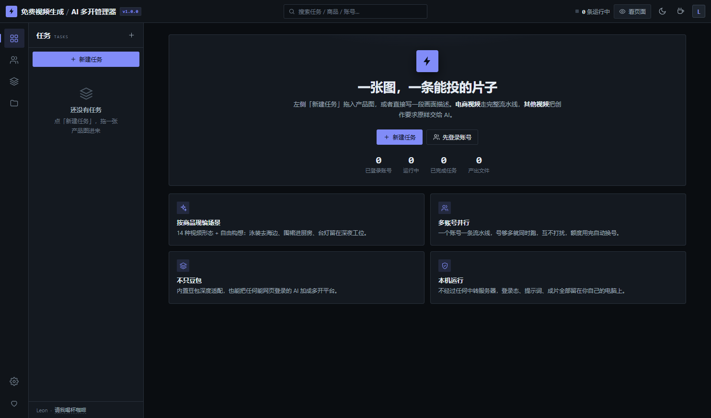
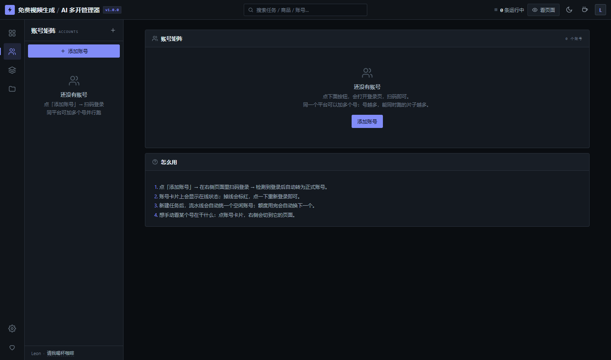
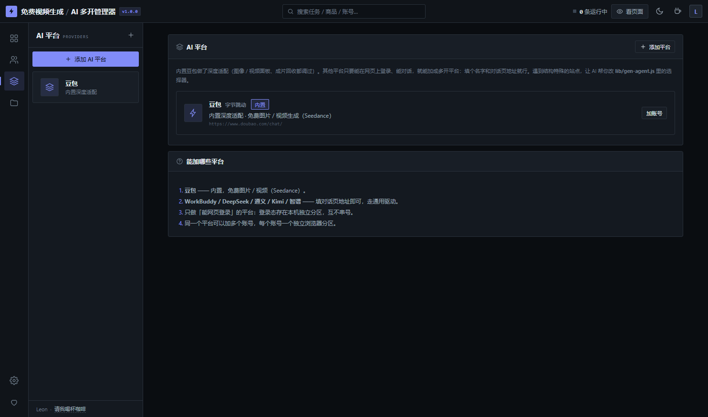
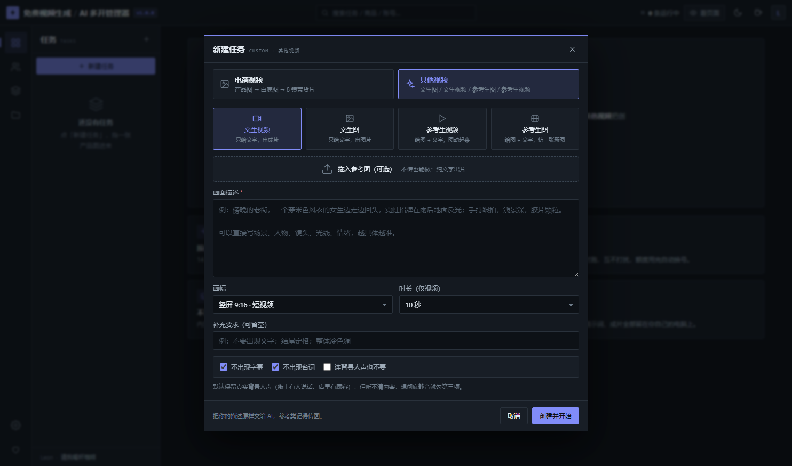

# Look · 视频生成 + AI 多开管理器

<p align="center">
  <b>把一张产品图，变成一条能投的带货片。</b><br>
  <sub>Electron 桌面程序 · 本地运行 · 不调用任何第三方厂商 API · MIT 开源</sub>
</p>

<p align="center">
  
</p>

---

## 这是什么

一个**完全跑在你自己电脑上**的 AI 视频工作台。它不是 AI 套壳，也不是 API 转售：

> 它就是一个「浏览器多开 + 网页自动化」工具 —— 帮你把**你自己的 AI 账号**用起来。
> 你在网页上手动点一遍的流程，它替你点一百遍，而且多个号同时点。

- 🎬 **电商视频**：产品图 → 白底主图 → 分镜提示词（15s 8 镜 / 10s 6 镜 / 5s 4 镜）→ 竖屏带货片 → 自动回收
- 🎨 **其他视频**：文生图 / 文生视频 / 参考图生图 / 参考图生视频，自己写画面描述
- 👥 **账号多开**：一个号一个浏览器分区，登录态互不干扰，切号零等待
- 🔌 **平台可扩展**：豆包深度适配内置；WorkBuddy / DeepSeek / 通义 / Kimi 等**自己加**，填个地址就能多开
- 🔒 **数据不出本机**：没有中转服务器，不上传账号、提示词、生成内容
- 🧩 **源码全明文**：没有任何加密和 asar，改完重启就生效

---

## 界面

| 账号矩阵 | AI 平台 |
|---|---|
|  |  |

| 新建任务 · 其他视频 |
|---|
|  |

---

## 快速开始（普通用户）

1. 到 [Releases](../../releases) 下载最新版 `Look-v1.0.0.zip`
2. **完整解压**到一个可写目录（例如 `D:\Look\`）
   - ⚠️ 不要在压缩包里直接双击
   - ⚠️ 不要放到 `C:\Program Files\`
3. 双击 `Look.exe`
4. 账号矩阵 → **+ 添加账号** → 扫码登录你的 AI 账号
5. 新建任务 → 拖产品图 → 填商品名 → 创建并开始

打不开？双击 `环境检测与修复.bat`，它会告诉你缺什么、并支持一键修复。
详细图文步骤见 [`文档/使用说明.md`](src/docs/使用说明.md)。

---

## 从源码运行（开发者）

需要 Node.js 18+ 和一条命令：

```bash
git clone https://github.com/<your-name>/leon-video-studio.git
cd leon-video-studio
npm install          # 只装 electron 一个开发依赖
npm start
```

如果你手上是**发布包**（已含 Electron 运行时），把本仓库的 `src/` 覆盖到：

```
<程序目录>/resources/app/
```

然后重启程序即可。源码没有打包成 asar，改一行就能看到效果。

> 也可以用 `一键安装（开发版）.bat`，它会检查 Node、装依赖、直接启动。

---

## 它是怎么工作的

```
┌──────────────────────────────────────────────────────┐
│ 主窗口（渲染层：看板 / 账号 / 平台 / 产出 / 设置）      │
│   └─ WebContentsView 池                              │
│        ├─ 账号 A → persist:账号A 分区（独立登录态）     │
│        ├─ 账号 B → persist:账号B 分区                 │
│        └─ 账号 C → 跑任务时移到离屏 worker 窗口        │
└──────────────────────────────────────────────────────┘
          │                     │
          │ IPC                 │ 注入页面探针
          ▼                     ▼
   lib/ext.js  ──►  lib/pipeline.js  ──►  driver.js / generic-agent.js
   （任务队列）      （流程编排）           （点按、传图、等待、下载）
                        │
                        ▼
                  lib/prompt.js
            （Seedance 三层骨架 + 14 形态动作链）
```

**核心设计**

| 设计 | 为什么 |
|---|---|
| 单窗口 + 视图池，而不是多窗口 | 切号只是 `addChildView` / `removeChildView`，毫秒级，页面状态不丢 |
| 每个账号一个 `persist:` 分区 | 登录态天然隔离，等于浏览器多开，但不是多开一堆窗口 |
| 任务跑在离屏 worker 窗口 | 后台跑任务不抢焦点，你还能继续用主界面 |
| 平台注册表（`lib/providers.js`） | 「多开管理器」能不能管别的 AI，是数据问题，不是代码问题 |
| 双驱动（doubao / generic） | 豆包走深度适配（认得出图像/视频面板）；其他站走通用探针 |
| 提示词三层骨架 | 固定参数 / 时间轴分镜 / 约束与规格，换品类只改数据不改结构 |
| 形态引擎 + 技法按需注入 | 14 种视频形态决定拍法；真实感 / 运镜 / 参考图锁由 `lib/craft.js` 按形态注入，不堆成通用禁令 |

---

## 项目结构

```
src/
├─ main.js                 主进程：窗口、视图池、账号、托盘、登录监控、保活
├─ preload.js              contextBridge 暴露的 window.api
├─ index.html              渲染层骨架（左 rail + 列表面板 + 主舞台）
├─ style.css               设计 token（明/暗）+ 全部样式
├─ renderer.js             视图路由、面板/舞台渲染、弹层、主题
├─ task-ui.js              新建任务弹层 + 任务详情（步骤条、参数、提示词、产出）
├─ docs/                   使用说明 / AI 使用说明 / 免责声明
├─ skills/seedance-prompt/ Seedance 提示词写作方法（可给 AI 读）
├─ _refs/                  第三方仓库原文留档（不参与运行）
└─ lib/
   ├─ ext.js               任务流水线 IPC 装配 + 自检 + 文档打开
   ├─ pipeline.js          任务执行：runTask（电商）/ runOtherTask（其他视频）
   ├─ driver.js            豆包深度适配驱动
   ├─ page-agent.js        注入豆包页面的探针（window.__DB）
   ├─ generic-agent.js     通用平台驱动（方法名与 driver.js 一致）
   ├─ gen-agent.js         注入任意 AI 网页的通用探针（window.__GEN）
   ├─ prompt.js            提示词引擎（Seedance 公式 + 其他视频请求）
   ├─ craft.js             第三方技法：参考图身份锁 / 相机缺陷词 / 运镜景别词表 / 各形态技法
   ├─ product.js           商品理解（按品类给场景/光线/动作链）
   ├─ product-forms.js     14 种商品形态的真实动作链
   ├─ formats.js           画幅 / 时长 / 平台规格
   ├─ fit.js               白底主图归一化（纯 nativeImage 实现）
   ├─ providers.js         AI 平台注册表
   └─ store.js             tasks.json 持久化
```

---

## 常见问题

<details>
<summary><b>要不要买 API / 要不要付费？</b></summary>

不用。全部走你自己账号的平台免费额度。程序本身免费开源。
</details>

<details>
<summary><b>会不会封号？</b></summary>

程序做的是「你自己手动也会做的事」，只是自动化了。但任何自动化都有风险：号别太多、别 24 小时不停跑、别跑违规内容。
</details>

<details>
<summary><b>能同时跑几条？</b></summary>

等于你在线且有空额度的账号数（一个号同时一条）。
</details>

<details>
<summary><b>能不能接别的 AI 平台？</b></summary>

能。界面「AI 平台 → 添加平台」，填名字 + 对话页地址就行，走通用驱动。
个别站点结构特殊，改 `lib/gen-agent.js` 里的选择器即可。
</details>

<details>
<summary><b>为什么不用 asar 打包？为什么不用 TypeScript？</b></summary>

故意的：用户要能打开 `resources/app/` 直接改代码，遇到平台改版能自己（或让 AI）补一行选择器。加编译步骤就失去了这个能力。
</details>

<details>
<summary><b>出问题了怎么让人工智能帮我修？</b></summary>

把 [`文档/AI使用说明.md`](src/docs/AI使用说明.md) 整份 + 一张截图发给任意 AI，它读完就知道该改哪个文件。
里面写了这一版改过什么、已知有哪些坑、改哪类东西要连带改哪里。
</details>

更多见 [`docs/常见问题.md`](docs/常见问题.md)。

---

## 自己打包一个发布版

默认不发 asar，直接把 Electron 运行时 + 源码放进一个文件夹：

```bash
# 1. 准备 Electron 运行时（已解压的 electron-vXX-win32-x64）
# 2. 把源码放进 resources/app/
# 3. 需要改图标与版本信息：
rcedit Look.exe --set-icon app.ico \
  --set-version-string "ProductName" "Look" \
  --set-version-string "CompanyName" "Leon" \
  --set-file-version "1.0.0.0" --set-product-version "1.0.0.0"
# 4. 打 zip
```

完整流程（含 Release、tag、更新说明）见 [`docs/发布流程.md`](docs/发布流程.md)。

---

## 免责声明

本软件是**本地浏览器多开与自动化辅助工具**，不提供、不代理、不转售任何 AI 服务。
所有生成内容由对应 AI 平台的账号产出，责任以该平台条款为准。
请使用你自己合法拥有的账号，遵守平台规则与当地法律；商用前自行确认素材与肖像授权。

完整条款见 [`免责声明.md`](免责声明.md)。**开始使用即视为同意。**

界面中出现的「豆包」「DeepSeek」「WorkBuddy」「通义」「Kimi」「智谱」等名称仅用于说明兼容性，商标归各自权利人所有，本项目与上述公司**无隶属或合作关系**。程序图标为作者自绘，未使用任何厂商商标素材。

---

## License

[MIT](LICENSE) © 2026 Leon

### 第三方内容

提示词技法部分融合了两个公开仓库的可执行规则（代码仍为 MIT；第三方原文留档在 `_refs/`，不参与运行，仅供改技法时查证）：

| 来源 | 许可 | 用到了什么 |
|---|---|---|
| [`LearnPrompt/awesome-seedance`](https://github.com/LearnPrompt/awesome-seedance) | 模板策展 CC BY 4.0 / 仓库代码 MIT | 参考图身份锁、手持 UGC 相机缺陷词、第一人称开场与硬切声明、美食 ASMR 声音顺序、穿搭逐件锁、过程类不变量 |
| [`dexhunter/seedance2-skill`](https://github.com/dexhunter/seedance2-skill) | MIT | @引用语法、高级运镜术语、景别词汇、避坑清单 |

只提炼规则与词汇，不复制整段提示词原文；提炼明细与署名见
[`src/skills/seedance-prompt/references/third-party-craft.md`](src/skills/seedance-prompt/references/third-party-craft.md)。

---

## 关于

作者 Leon。本项目按 MIT 许可开源，有问题、想加功能、想改提示词，欢迎直接提 Issue / PR，
也欢迎把改好的版本继续开源出去。
